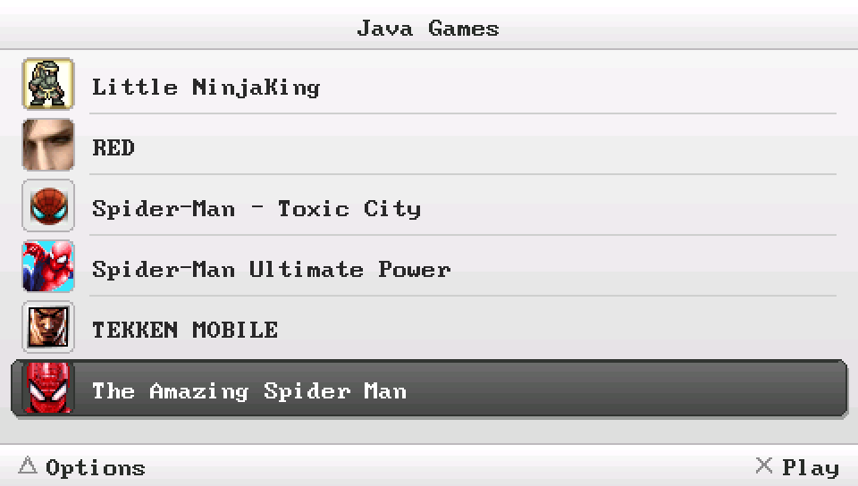
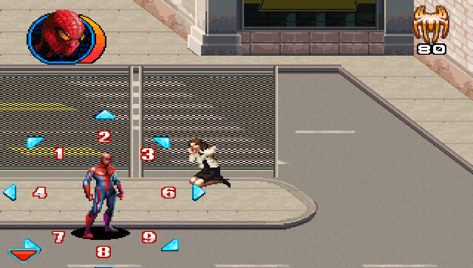
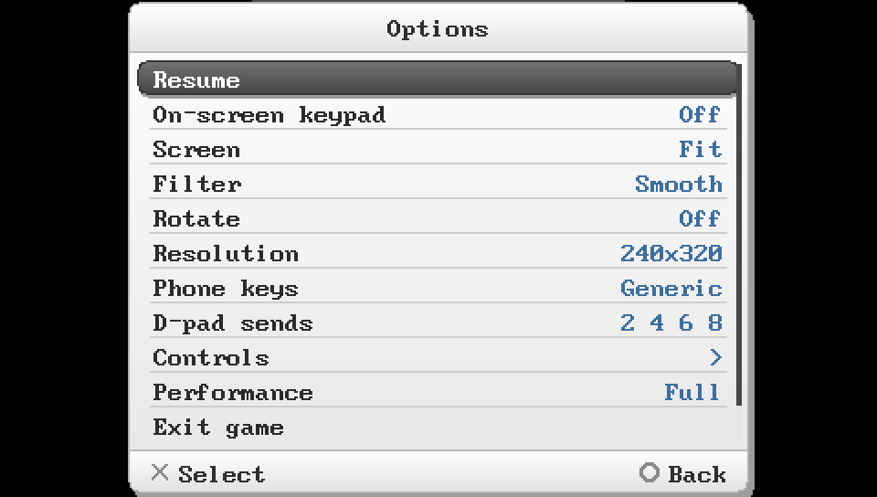
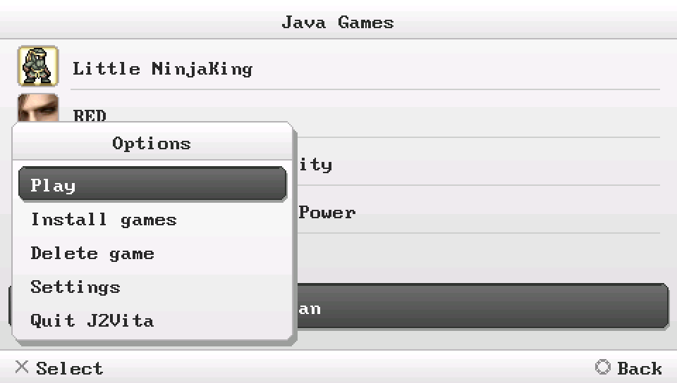

<p align="center">
  
</p>

<h1 align="center">J2Vita</h1>

<p align="center">
  Play your old Java ME (J2ME) phone games on the PS Vita.
</p>

---

J2Vita runs MIDP 2.0 / CLDC 1.1 games, the `.jar` games every phone had before smartphones, on
the PS Vita. It's built on PSPKVM, the Java ME virtual machine for the PSP, which itself is based
on Sun's open source phoneME Feature VM. The Java side is mostly left alone; the Vita side (video,
input, sound, menus) was rewritten for the Vita.

> [!IMPORTANT]
> **No games are included here or in the release.** Bring your own `.jar` files.

<p align="center">
  
  
</p>
<p align="center">
  
  
</p>

The game compatibility list lives on the [project page](https://kiddrwxssj.github.io/j2vita/).

## Download & Install

Grab `j2vita.vpk` from the [Releases](../../releases) page and install it with VitaShell. You
need a Vita on HENkaku/Ensō and `libshacccg.suprx`, which most homebrew already needs (install it
with [ShaRKBR33D](https://github.com/Rinnegatamante/ShaRKBR33D/releases) if you don't have it).

Then add some games:

1. Copy your `.jar` files to `ux0:data/j2vita/games/`.
2. Open J2Vita and press **Square** (or Triangle > Install games).
3. Pick a game. It shows up in the list right away.

```
ux0:data/j2vita/
├── games/      your .jar files go here
├── config/     settings (default.cfg + one file per game)
└── log.txt     useful when something breaks
```

Games keep their saves in `ux0:data/j2vita/appdb/`, so updating J2Vita doesn't touch them.

## Controls

**Game list**

| Vita | Does |
|---|---|
| Cross | Play |
| Triangle / L / Start | Options: install, delete, settings, quit |
| Square | Install games |
| SELECT | Settings |

**In game** (defaults; every game can have its own mapping)

| Vita | Phone key |
|---|---|
| D-Pad / Left stick | Arrows (or 2 4 6 8, see "D-pad sends") |
| Cross | 5 |
| Circle / R | Right soft key |
| L / Start | Left soft key |
| Square / Triangle | `*` / `#` |
| Right stick | 2 / 8 / 4 / 6 |
| SELECT (tap) | Menu, the game pauses |
| SELECT (hold) | On-screen keypad |

The touchscreen works as the phone's touchscreen.

The **on-screen keypad** is there for cheat codes and anything that needs a key the Vita doesn't
have. Move with the D-Pad, press with Cross (it's held for as long as you hold Cross), Square moves
the keypad to the other side and Circle hides it. You can also just tap the keys.

## Settings

* **Global settings** (SELECT on the game list): theme, screen scaling, filter, phone key set,
  D-pad mode, controls and the performance overlay. Every game starts from these.
* **In-game menu** (SELECT while playing): the same options plus rotation and resolution. A game
  only remembers what you change inside it; everything else keeps following the global settings.
* **Themes**: White (default), Black, Blue and Green.
* **Performance overlay**: `FPS` shows the frame rate, `Full` adds how busy the Java VM is. Java
  games pick their own frame rate, so a low number isn't always a problem: if the load stays under
  ~97% the game is running at the speed it was made for. `CPU bound` means the Vita can't keep up.
* **Resolution** is guessed from the game's name and manifest the first time. If a game looks
  cropped or tiny, change it and restart the game.

## AI Assistance

Parts of the code were written or improved with the assistance of AI (Claude, by Anthropic). That
includes most of the Vita side: the video and input layer, the menus and launcher, the themes, the
on-screen keypad and the performance overlay, and a good part of the bug fixing. All AI-assisted
code was reviewed, tested, and manually validated on a real PS Vita, with the overall
implementation and debugging process remaining under human supervision.

## Credits

* **Sun Microsystems** for phoneME Feature (CLDC, MIDP and javacall), released as open source
  under the GPL v2.
* **The PSPKVM team** (Sleepper, M@x, Anweifeng, AJ Milne and Jurgen Konings) for PSPKVM, which
  J2Vita is built on. Their original readme and changelog are kept in `Readme.txt` and
  `CHANGELOG.TXT`.
* **The earlier PSPKVM Vita port** (v0.1.86), the first attempt at bringing PSPKVM to the Vita,
  which J2Vita started from.
* **vitaGL** by Rinnegatamante.
* **SDL2** and **SDL2_mixer** by the SDL team, with its TiMidity code for MIDI.
* **FreePats** by the Free Software Foundation, the instrument set used for MIDI music.
* **FreeType**, **libpng** and **zlib**.
* **VitaSDK** and the Vita homebrew scene.

Java and the Java coffee cup logo are trademarks of Oracle and/or its affiliates. PlayStation and
PS Vita are trademarks of Sony Interactive Entertainment. J2Vita isn't affiliated with or endorsed
by either of them, or by the makers of any game shown here. Game screenshots belong to their
respective owners.

## License

J2Vita is free software under the **GNU General Public License, version 2**, the same license as
phoneME Feature and PSPKVM. See [LICENSE](LICENSE). Third-party parts keep their own licenses:
vitaGL (LGPL v3), SDL2 and SDL2_mixer (zlib), FreePats (GPL v2 or later, with an exception for
music made with it), FreeType (FTL), libpng and zlib.

## Building from source

You need [VitaSDK](https://vitasdk.org) with these vdpm packages: `vitaGL vitaShaRK libmathneon
SceShaccCgExt sdl2 sdl2_mixer freetype libpng zlib bzip2` (plus SDL2_mixer's own codec
dependencies), a **JDK 8**, and a host compiler that can build 32-bit binaries (`g++ -m32`), which
the ROM generator needs.

```bash
JDK_DIR=/path/to/jdk8 ./build.sh
```

`HOST32_BIN` can point at gcc/g++ wrappers if your `-m32` setup lives somewhere else. The VPK ends
up in `vita/j2vita.vpk`. The build fetches a pinned vitaGL (without the boot splash) and the
FreePats instruments the first time.
